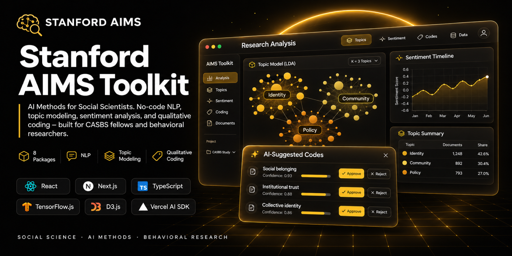

<div align="center">
  

  <br />
  <br />

  [](https://doi.org/10.5281/zenodo.24243341)
  [](https://www.npmjs.com/package/@aims/core)
  [](LICENSE)
  [](https://www.typescriptlang.org/)
  [](https://react.dev/)
  [](https://nextjs.org/)

  **AI Methods for Social Scientists** — no-code NLP, topic modeling, sentiment analysis, and qualitative coding. Built for CASBS fellows and behavioral researchers.
</div>

---

## Packages

| Package | Description | Version |
|---------|-------------|---------|
| [`@aims/core`](packages/core) | Dataset loading, validation, project management | [](https://www.npmjs.com/package/@aims/core) |
| [`@aims/nlp`](packages/nlp) | Tokenization, NER, text stats, language detection | [](https://www.npmjs.com/package/@aims/nlp) |
| [`@aims/sentiment`](packages/sentiment) | Sentiment scoring, emotion detection, aspect analysis | [](https://www.npmjs.com/package/@aims/sentiment) |
| [`@aims/topics`](packages/topics) | LDA topic modeling, coherence scoring | [](https://www.npmjs.com/package/@aims/topics) |
| [`@aims/coding`](packages/coding) | Qualitative coding, inter-rater reliability | [](https://www.npmjs.com/package/@aims/coding) |
| [`@aims/embeddings`](packages/embeddings) | Text embeddings, clustering, dimensionality reduction | [](https://www.npmjs.com/package/@aims/embeddings) |
| [`@aims/survey`](packages/survey) | Descriptive stats, cross-tabs, factor analysis | [](https://www.npmjs.com/package/@aims/survey) |
| [`@aims/export`](packages/export) | CSV/JSON export, APA methods generator, SVG export | [](https://www.npmjs.com/package/@aims/export) |

## Features

- **No-Code NLP** — Tokenization, stopword removal, stemming, and named entity recognition
- **Sentiment Analysis** — AFINN lexicon-based scoring with emotion detection and temporal tracking
- **Topic Modeling** — LDA with automatic optimal topic estimation and coherence scoring
- **Qualitative Coding** — AI-assisted coding with codebook management and inter-rater reliability (Cohen's kappa, Krippendorff's alpha)
- **Text Embeddings** — Dimensionality reduction (t-SNE, PCA) and clustering (k-means, DBSCAN)
- **Survey Analysis** — Descriptive statistics, cross-tabulation, Cronbach's alpha, and factor analysis
- **Export** — CSV/JSON output, APA-format methods sections, and SVG visualization export
- **TypeScript-First** — Full type safety across all packages

## Quick Start

```bash
# Install packages
pnpm add @aims/core @aims/nlp @aims/sentiment

# Or install everything
pnpm add @aims/core @aims/nlp @aims/sentiment @aims/topics @aims/coding @aims/embeddings @aims/survey @aims/export
```

```typescript
import { loadCSV, validateDataset } from '@aims/core';
import { tokenize, removeStopwords } from '@aims/nlp';
import { analyzeSentiment } from '@aims/sentiment';

// Load and validate your dataset
const dataset = await loadCSV('responses.csv');
const validated = validateDataset(dataset);

// Process text
const tokens = tokenize(validated.rows[0].text);
const cleaned = removeStopwords(tokens);

// Analyze sentiment
const result = analyzeSentiment(validated.rows[0].text);
console.log(result.score, result.comparative, result.emotions);
```

## Tech Stack

- **TypeScript 5.8** — Strict mode, full type safety
- **Turborepo** — Monorepo build orchestration
- **pnpm** — Fast, disk-efficient package manager
- **Changesets** — Version management and changelogs

## License

[MIT](LICENSE) -- Copyright (c) 2026 Ahmed Allem
